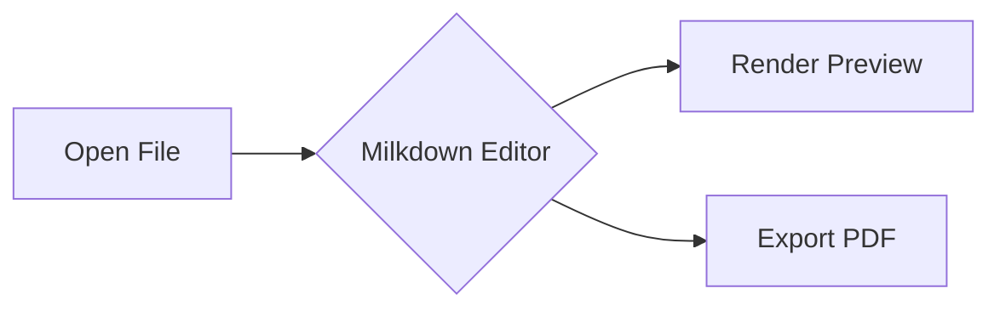

# Heading 1 — ELmark Smoke Test

## Heading 2 — Inline & Block Formatting

This paragraph verifies **bold text**, *italic text*, `inline code`, ~~strikethrough~~, and an [external link](https://example.com).

### Heading 3 — Task & Ordered Lists

- [x] Verify YAML Frontmatter parsing
- [ ] Verify Mermaid flowchart rendering

1. First ordered item
2. Second ordered item

#### Heading 4 — GFM Table

| Feature | Engine | Status |
| --- | --- | --- |
| WYSIWYG Editing | Milkdown / ProseMirror | Ready |
| Diagrams | Mermaid 11 | Ready |
| Syntax Highlighting | lowlight / highlight.js | Ready |

##### Heading 5 — Mermaid Flowchart



###### Heading 6 — HTML & TypeScript Code

<details>
<summary>Keyboard Shortcut Hint (Click to expand)</summary>

Press <kbd>Ctrl</kbd> + <kbd>S</kbd> to save the active Markdown document.

</details>

```typescript
export function greetELmark(name: string): string {
  return `Hello, ${name}!`;
}
```
